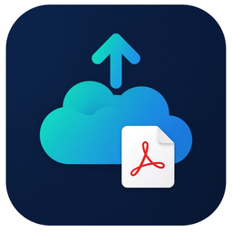

# Bilky · Subir facturas (Windows)

Aplicación de escritorio para subir un lote de PDF a [Bilky](https://asesoriacolon.bilky.es/) (portal asesor → Gestión contable) sin repetir el flujo manual en el navegador.



## Descarga (compañeros)

1. Abre **[Releases](https://github.com/carlosginergonzalez/bilky-subir-facturas/releases)** en GitHub.
2. Descarga el ZIP más reciente: `BilkySubirFacturas-x.y.z-win64.zip`.
3. Descomprímelo en una carpeta (p. ej. `Escritorio\BilkySubirFacturas`).
4. Ejecuta **`BilkySubirFacturas.exe`** (no hace falta Python ni `run.bat`).

La primera ejecución pide usuario/contraseña de Bilky; se guardan solo en ese PC.

## Uso

1. **Elegir carpeta** con los PDF del lote.
2. **Buscar cliente** como en Gestión contable (ej. `GINER GONZALEZ`).
3. Tipo de documento (por defecto **Factura recibida**).
4. **Iniciar subida** — conviene dejar activo *Mostrar navegador* la primera vez.

Si falla, revisa el registro en la app y capturas en  
`%LOCALAPPDATA%\BilkySubirFacturas\screenshots\`.

## Desarrollo

```powershell
cd "C:\Cursor\BILKY - SUBIR FACTURAS"
py -m venv .venv
.\.venv\Scripts\pip install -r requirements.txt
.\.venv\Scripts\playwright install chromium
.\.venv\Scripts\python run_app.py
```

## Crear release (mantenedores)

```powershell
.\scripts\build_release.ps1
```

Sube el ZIP generado en `dist\` como asset del release en GitHub (`gh release create ...`).

## Seguridad

- No subas credenciales al repositorio.
- El ZIP incluye Chromium de Playwright para no depender de instalaciones extra en cada PC.

## Licencia

Uso interno de la asesoría.